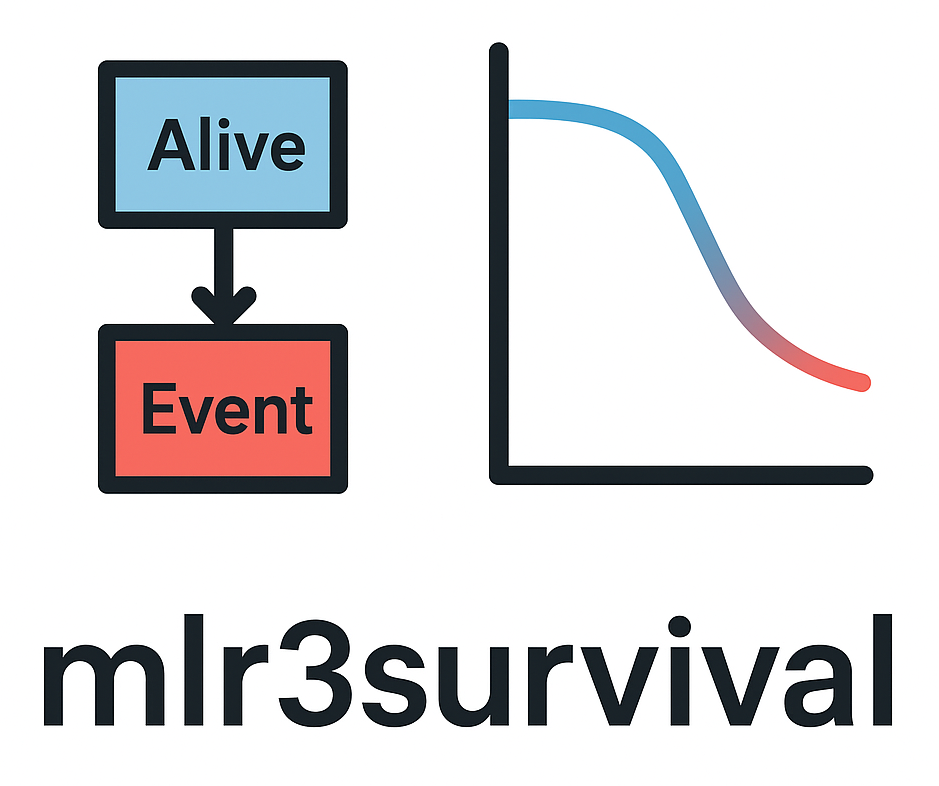

# mlr3survival 

 This package is
**under development** and it does not yet replace *mlr3proba*

Package website: [release](https://mlr3survival.mlr-org.com/)

Survival analysis with ‘mlr3’.

<!-- badges: start -->

[](https://github.com/mlr-org/mlr3survival/actions/workflows/r-cmd-check.yml)
[](https://cran.r-project.org/package=mlr3survival)
[](https://lmmisld-lmu-stats-slds.srv.mwn.de/mlr_invite/)
<!-- badges: end -->

## Installation

Install the development version from GitHub:

``` r
# install.packages("pak")
pak::pak("mlr-org/mlr3survival")
```

## Example

## Measures

## Learners

## Citation

## Code of Conduct

This project follows a [Contributor Code of
Conduct](https://mlr3survival.mlr-org.com/CODE_OF_CONDUCT.html). By
contributing to this project, you agree to abide by its terms.
